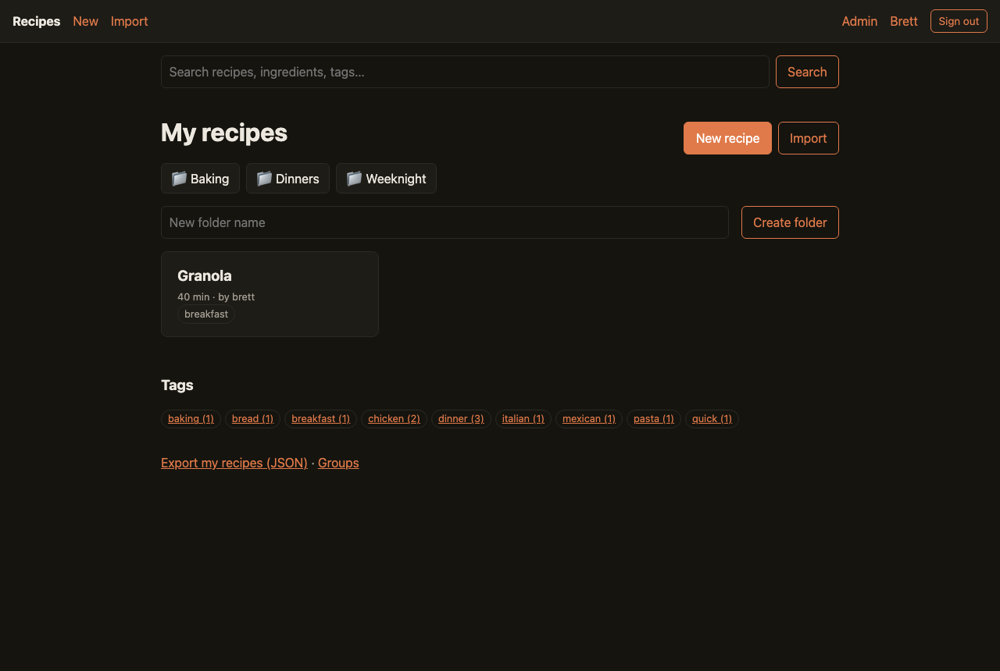
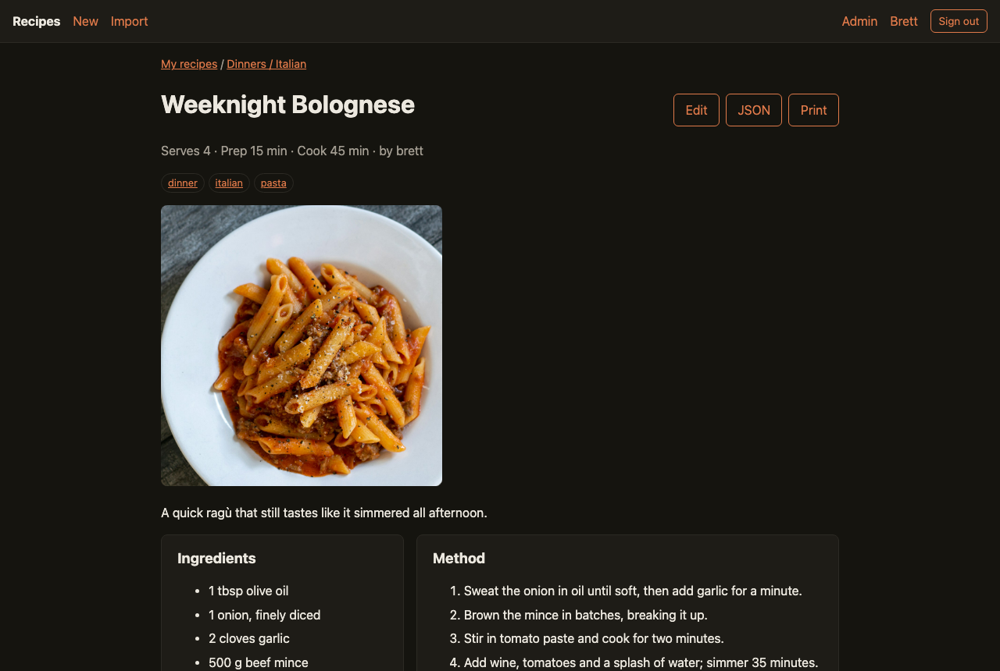
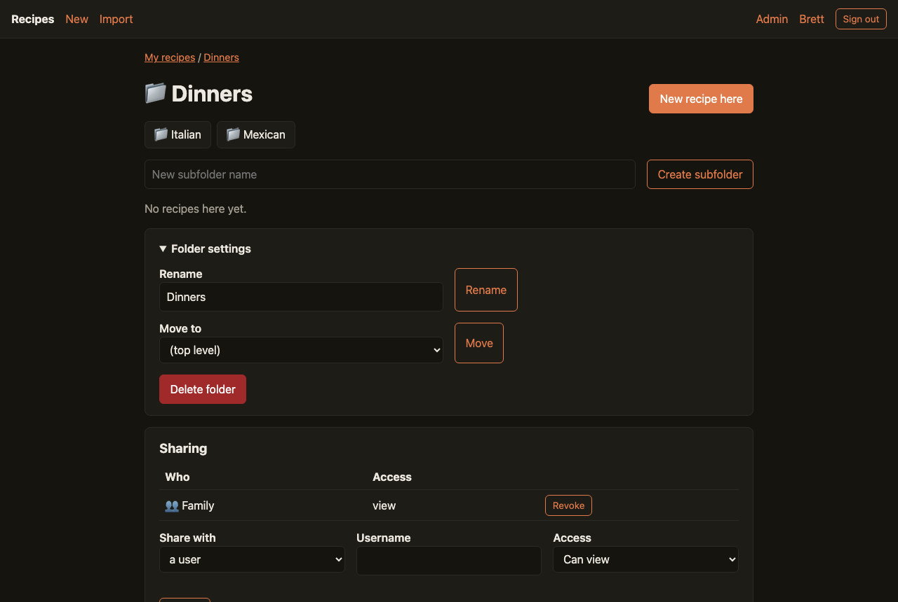
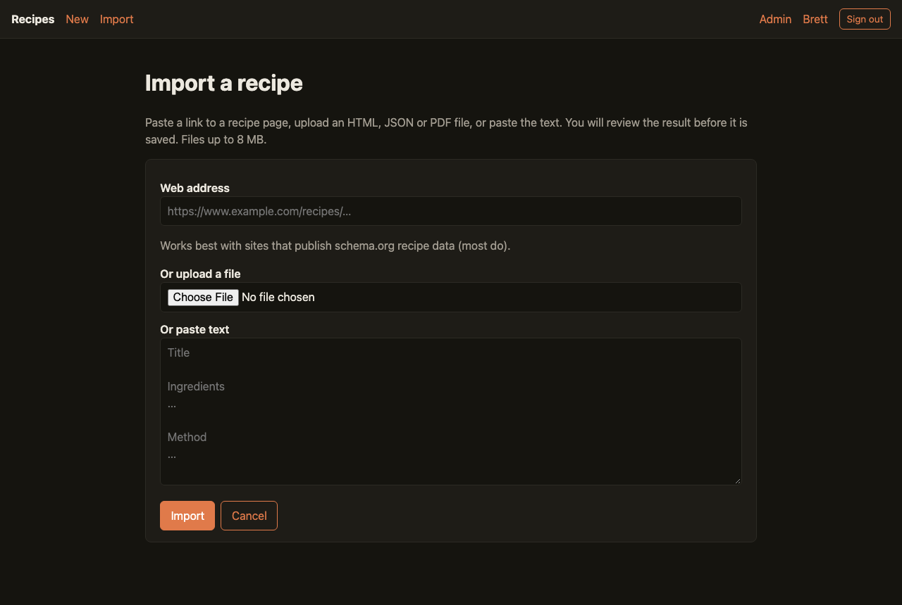
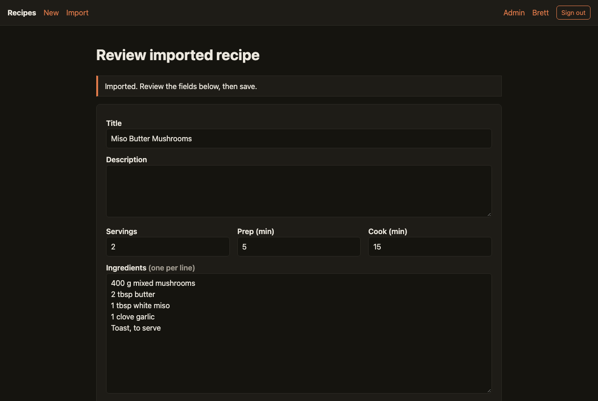
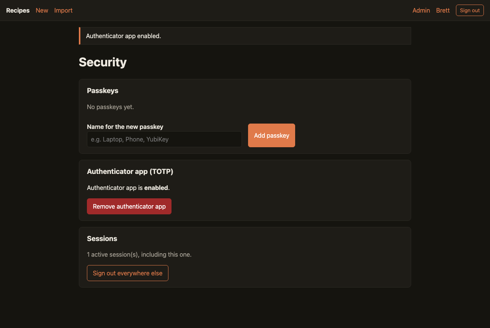
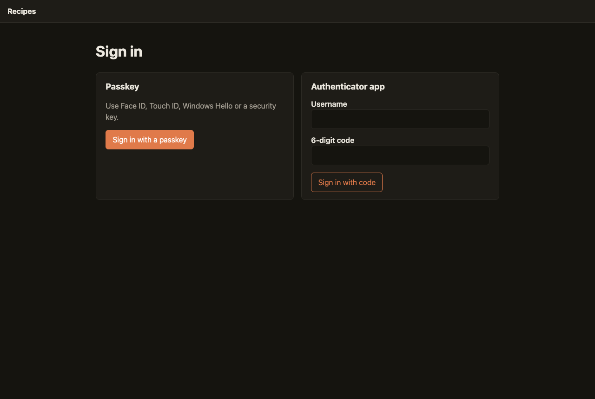

# recipe-manager

A small, self-hosted recipe manager built to sit on the public internet behind
Cloudflare. Passwordless by design: every account signs in with a **passkey**
(WebAuthn) or a **TOTP authenticator app**, and at least one is required.
Single static Go binary, SQLite storage, no JavaScript framework, strict
Content-Security-Policy, runs natively or in a distroless container as an
unprivileged user.



## Features

- **Recipes** with ingredients, method, tags, servings, prep/cook time, source
  and image links and free-form notes. Full-text-ish search across titles,
  descriptions, ingredients and tags. Print stylesheet.
- **Folders**: each user organises recipes in their own nested folder tree.
- **Sharing**: share a single recipe or a whole folder subtree with a user or a
  **group**, as *view* or *edit*. Permissions are resolved server-side in one
  recursive SQL query (owner → direct share → ancestor-folder share → group
  membership).
- **Import** from a URL, an uploaded HTML/JSON/PDF/text file, or pasted text.
  schema.org/Recipe JSON-LD is used when present, with heuristics as fallback.
  The result opens in the editor for review before anything is saved.
- **Export** any recipe, or all your recipes, as schema.org JSON.
- **Accounts**: first run creates the admin; everyone else joins via a
  single-use invite link. Admins manage users; anyone can create groups.
- **Security settings**: add/remove passkeys, enrol or remove an authenticator
  app (the last method can never be removed), sign out everywhere else.

| | |
|---|---|
|  |  |
|  |  |
|  |  |

More in [`docs/screenshots/`](docs/screenshots/).

## Quick start

### Docker (recommended)

```sh
git clone https://github.com/brett6320/recipe-manager.git
cd recipe-manager
RM_PUBLIC_URL=https://recipes.example.com docker compose up -d --build
```

The container listens on `127.0.0.1:8080`, stores data in the `recipe-data`
volume, runs as uid 65532 with a read-only root filesystem, all capabilities
dropped and `no-new-privileges`. Put Cloudflare in front of it (see
[Deployment](docs/deployment.md)) and open `https://recipes.example.com/setup`
once to create the admin account.

### Native binary

```sh
go build -o recipe-manager ./cmd/recipe-manager
RM_PUBLIC_URL=https://recipes.example.com RM_DATA_DIR=/var/lib/recipe-manager ./recipe-manager
```

A hardened systemd unit is provided in
[`deploy/recipe-manager.service`](deploy/recipe-manager.service).

### Local development

```sh
RM_PUBLIC_URL=http://localhost:8765 RM_LISTEN=127.0.0.1:8765 RM_DEV_INSECURE=true \
RM_TRUSTED_PROXIES=none RM_LOG_JSON=false go run ./cmd/recipe-manager
```

`RM_DEV_INSECURE` allows a plain-http public URL and drops the `__Host-` cookie
prefix. Passkeys work on `localhost` without TLS in all major browsers.

## Configuration

Everything is configured through environment variables.

| Variable | Default | Purpose |
|---|---|---|
| `RM_PUBLIC_URL` | *(required)* | Canonical `https://host` users see. Sets the WebAuthn relying-party ID and the CSRF origin. |
| `RM_LISTEN` | `127.0.0.1:8080` | Bind address. |
| `RM_DATA_DIR` | `./data` | Holds `recipes.db` and `secret.key` (created with mode 0600, encrypts TOTP seeds). Back this directory up. |
| `RM_TRUSTED_PROXIES` | `cloudflare` | Comma list of CIDRs/IPs whose `CF-Connecting-IP` / `X-Forwarded-For` is trusted. `cloudflare` expands to Cloudflare's published ranges; `none` trusts nobody. Add `127.0.0.1` when using a local `cloudflared` tunnel. |
| `RM_REQUIRE_PROXY` | `false` | Reject connections that do not come from a trusted proxy. Turn on when the origin is directly reachable, so Cloudflare cannot be bypassed. |
| `RM_TLS_CERT` / `RM_TLS_KEY` | | Serve TLS directly (Cloudflare Origin Certificate works well). |
| `RM_TLS_CLIENT_CA` | | Require client certificates signed by this CA: use Cloudflare's Authenticated Origin Pulls CA so only Cloudflare can talk to the origin. |
| `RM_SESSION_TTL` | `720h` | Absolute session lifetime. |
| `RM_SESSION_IDLE` | `168h` | Idle timeout. |
| `RM_LOG_JSON` | `true` | JSON logs to stdout (`false` for text). |
| `RM_DEV_INSECURE` | `false` | Local development only. |

## Security model

See [`docs/security.md`](docs/security.md) for the full write-up. In short:

- **No passwords.** Passkeys require user verification and are stored as
  public keys; TOTP seeds are AES-GCM encrypted at rest with a per-instance
  key, and each accepted code's time step is recorded so codes cannot be
  replayed. Five failures lock an IP and a username for 15 minutes.
- **Sessions** are 256-bit random tokens stored hashed, in `__Host-`,
  `Secure`, `HttpOnly`, `SameSite=Strict` cookies with absolute and idle
  expiry.
- **CSRF** is blocked by SameSite=Strict plus a Fetch-Metadata/Origin check on
  every state-changing request. No inline scripts; CSP is
  `default-src 'none'` with explicit allowances.
- **Authorisation** is enforced in SQL for every object; objects you cannot see
  return 404, actions you cannot take return 403.
- **Imports** are sandboxed: the URL fetcher only connects to globally
  routable IPs on ports 80/443, pins the resolved address, re-validates
  redirects and caps size and time. Every imported string is tag-stripped,
  control/zero-width/bidi-cleaned and length-capped before it reaches the
  editor, and nothing is stored until the user saves.
- **Least privilege**: static binary, distroless `nonroot` image, read-only
  filesystem, `cap_drop: ALL`, systemd sandboxing, one writable directory.
- **Supply chain**: ~10 direct Go dependencies, `govulncheck`, CodeQL,
  gosec/golangci-lint and hadolint in CI, Dependabot for Go, Actions and
  Docker.

## Development

```sh
go test ./...                                   # unit + HTTP integration tests
go run github.com/golangci/golangci-lint/v2/cmd/golangci-lint@latest run ./...
go run tools/screenshots/main.go                # regenerate docs/screenshots against a fresh local instance
```

Project layout:

```
cmd/recipe-manager     entrypoint, TLS, graceful shutdown, -healthcheck
internal/config        environment configuration
internal/db            SQLite open + embedded migrations
internal/httpx         security middleware (real IP, headers, CSRF, rate limits)
internal/auth          users, passkeys, TOTP, sessions, invites
internal/recipes       recipes, folders, groups, shares, sanitisation
internal/importer      SSRF-safe fetcher and HTML/JSON-LD/PDF/text parsers
internal/server        routes, handlers, templates
web/                   templates and static assets (embedded)
deploy/                systemd unit and cloudflared example
docs/                  deployment and security guides, screenshots
```

## License

MIT. See [LICENSE](LICENSE).
